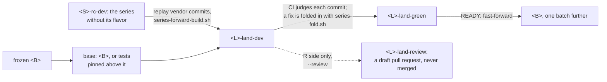

# Landing a series on its branch

*Handbook: [`operations/releases/process/`](/handbook/operations/releases/process/README.md),
the release process, of which a landing is how a canonical branch takes vendored commits.*

Every canonical branch that carries an engine takes it from its own series, a batch at a time,
by **fast-forwarding onto that series' vendor commits**:
every upstream commit the series vendored since the branch's last landing, with the R-side fix CI demanded folded into it,
replayed without the flavor onto the branch itself and judged by CI one by one,
and then the version bump written by hand, the landing's last commit (step 3).
Nothing else reaches the branch:
no flavor, no seed, and no port, because everything a port carries is the branch's already.

* **`main`'s own series onto `main`** is the routine case.
  `main` carries upstream `main`'s engine and releases nothing, so it lands whenever a batch is worth it,
  with no upstream release to wait for, and the bump takes the fourth component one up.
* **A line's series onto its release branch**, `v2.0-cyanoptera`, is the same procedure:
  short of an upstream patch release the bump takes the fourth component one up, and with one it takes the release,
  and the branch is merged forward into the newer lines afterwards ([step 8](#8-merge-the-release-branch-forward)).
* **Changing the line CRAN ships**, when upstream releases the line `main` previewed, is the rarer case:
  a release branch is cut from `main` first, and the landing goes onto it
  ([Changing the line CRAN ships](#changing-the-line-cran-ships)).

The landings come often and stay small, so a rewind is rare:
the series is forwarded onto a branch that already vendors what the previous landing brought
([`series-forward`](/.claude/skills/series-forward/SKILL.md)).

`<S>` is the series that lands, always the serving one: a forward is cut over first, and never landed,
and `series-land.sh` refuses a `-fwd` series.
`<L>` names the landing's refs and is `<S>` itself: `main` for `main`'s series, `v2.0-cyanoptera` for v2.0's.
`<B>` is the canonical branch it lands on, `main` or the line's release branch:
the series' `releases_from` in `scripts/series.yaml`, which `series-land.sh` reads from the canonical `main`,
and `<v>` the version the bump sets ([`operations/releases/versioning/`](/handbook/operations/releases/versioning/README.md)).
Every command block below pastes as it stands, from the repository's root,
with `upstream` naming `duckdb/duckdb-r` and `origin` the fork:
it reads `<B>` with `series-land.sh --target`, and what a human chooses, the series first, is one variable at its top.

## The refs



* **`<L>-land-dev`**, in the fork: `<B>` plus the vendor commits and, last, the version bump, and nothing else.
  CI judges it like any `-dev` ([`scripts/each-plan.sh`](/scripts/each-plan.sh)).
* **`<L>-land-green`**, in the fork: where CI's judgement starts.
  It is pushed at the frozen `<B>` and advanced over the commits that passed;
  the landing is ready when it equals `<L>-land-dev`, the bump included.

* **`<L>-land-review`**, in the canonical repository: the same landing without its engine,
  for a draft pull request that is read and never merged (step 4).

There is no `<L>-land-build`, so the loop never mistakes the pair for a series.
One landing per line is in flight at a time, and all three are deleted once `<B>` has taken it.

## Before you start

* **The series is current.**
  `<S>` has taken every port of `main`, and its rc strand is aligned
  ([`series-rc`](/.claude/skills/series-rc/SKILL.md)); the build refuses an rc strand behind its source,
  and its tree check refuses a series that lacks something `main` has.
* **The convergence findings are settled**, when `<S>` is a forward
  ([`series-forward`](/.claude/skills/series-forward/SKILL.md), `scripts/series-converge.sh <L>`).
  The landing carries the forward's tree, so whatever the forward lost against its base is lost on `<B>` too.
* **Any forward of `<S>` is cut over.**
  A landing takes the serving series' rc strand, so a forward in flight is swapped in first, or deleted.
* **The series stands on `<B>`.**
  `<S>`'s seed is `<B>` as some earlier landing left it, and every port of `<B>` since is on it;
  a series seeded from another branch lands nothing the build can check.
  The replay starts above the vendor commit naming the engine `<B>` already vendors,
  so a series not forwarded since the previous landing lands only what came after it.

## 1. Freeze `<B>`

Every commit of the landing stands on one `<B>` commit, so `<B>` must not move until it fast-forwards.
The freeze lasts as long as CI takes over the batch, which is what keeps the batches small.
A ruleset with no bypass list stops every update, pull requests and admins included.
A human runs these, and reads each output before the next.

Inspect: the rulesets on `<B>`, and the commit it freezes at.

```sh
S=main                                      # the serving series that lands: main, or v2.0-cyanoptera
B=$(scripts/series-land.sh "$S" --target)   # the branch it lands onto, its releases_from
R=duckdb/duckdb-r
gh api repos/$R/rulesets --jq '.[] | [.id, .name, .enforcement] | @tsv'
gh api repos/$R/commits/$B --jq .sha
```

Freeze:

```sh
( set -eu
S=main                                      # the serving series that lands: main, or v2.0-cyanoptera
B=$(scripts/series-land.sh "$S" --target)   # the branch it lands onto, its releases_from
[[ $B =~ ^(main|v[0-9]+\.[0-9]+-[a-z]+)$ ]] || { echo "no branch to land onto: '$B'" >&2; exit 1; }
gh api -X POST repos/duckdb/duckdb-r/rulesets --input - <<EOF
{
  "name": "freeze $B",
  "target": "branch",
  "enforcement": "active",
  "bypass_actors": [],
  "conditions": {"ref_name": {"include": ["refs/heads/$B"], "exclude": []}},
  "rules": [
    {"type": "update", "parameters": {"update_allows_fetch_and_merge": false}},
    {"type": "deletion"},
    {"type": "non_fast_forward"}
  ]
}
EOF
)
```

Verify: an `update` row from the new ruleset, and `never`.

```sh
S=main                                      # the serving series that lands: main, or v2.0-cyanoptera
B=$(scripts/series-land.sh "$S" --target)   # the branch it lands onto, its releases_from
gh api repos/duckdb/duckdb-r/rules/branches/$B --jq '.[] | [.type, .ruleset_id] | @tsv'
id=$(gh api repos/duckdb/duckdb-r/rulesets --jq ".[] | select(.name == \"freeze $B\") | .id")
gh api repos/duckdb/duckdb-r/rulesets/$id --jq .current_user_can_bypass
```

The loop keeps running: it reads `<B>` and writes no ref there.

## 2. Write down what the batch ends at

The landing goes up to the tip of `<S>-rc-dev` as it stands when the build starts.
Read off the engine it vendors and the engine `<B>` vendors, for the review's description and the record the bump sets (step 3):

```sh
S=main                                      # the serving series that lands: main, or v2.0-cyanoptera
B=$(scripts/series-land.sh "$S" --target)   # the branch it lands onto, its releases_from
git fetch origin "$S-rc-dev" && git fetch upstream "$B"
engine() { git show "$1:src/duckdb/src/function/table/version/pragma_version.cpp" |
  sed -rn 's/^#define DUCKDB_SOURCE_ID "([0-9a-f]+)"$/\1/p'; }
for e in "$(engine "upstream/$B")" "$(engine "origin/$S-rc-dev")"; do   # the previous landing's, then this one's
  gh api "repos/duckdb/duckdb/commits/$e" --jq '[.sha, .commit.committer.date[0:10]] | @tsv'
done
```

## 3. Build the landing

```sh
S=main   # the serving series that lands: main, or v2.0-cyanoptera
scripts/series-land.sh "$S" --remote origin --canonical upstream          # build and check
scripts/series-land.sh "$S" --remote origin --canonical upstream --push   # and write both refs
```

It prints `<B>`'s tip as the commit it builds on; a series `scripts/series.yaml` does not declare lands on `main`.

**Tests that pin what the line must keep go underneath, not into the series afterwards.**
A pull request of tests written on `<B>`'s engine, one commit on the frozen `<B>`,
is the landing's base: `--base <its branch>`.
Its commit lands with the vendor commits, CI judges it from `<B>` up,
and the tree check expects it merged into the series' package,
so the series has to carry it too before the landing can pass:
port it by name, `scripts/series-port.sh <S> --apply <sha>`.

[`scripts/series-land.sh`](/scripts/series-land.sh) replays with
[`scripts/series-forward-build.sh`](/scripts/series-forward-build.sh) in a worktree it keeps,
so everything that script stops on stops here, and a rerun resumes:

* **a conflict**: resolve it in the kept worktree the way the series resolved it, `git add`, rerun.
  rerere records the resolution, and a rebuild that meets the same conflict continues on its own;
* **a commit that vendors nothing and is not `<B>`'s**: decide where its change belongs and pass `--placed <sha>`.
  Ports of commits `<B>` already has are placed by their `-x` trailer, and tooling syncs by their subject;
* **the glue gate**: fix the glue in the commit that broke it and rerun.

The build ends with the tree check:
the landing's tip must be the package the rc strand holds,
except for `NEWS.md` and the READMEs, which are `<B>`'s by construction.
Anything else is something `<B>` has and the series lacks, or the other way round.
Fix it on the series and realign its rc strand; a rerun follows the strand from where the build stands.
Nothing is pushed until the check passes.
Two things the check cannot see are reported beside it:

* **files the landing deletes from `<B>`** outside the vendored strand and the tests, which the series lacks too.
  Each is a file the series lost on the way; restore it on the series before pushing.
* **resolutions rerere replayed**, named when the check fails.
  A wrong one is replayed as faithfully as a right one:
  rebuild with `--abort` and then `--attended`, which stops at every conflict with rerere's answer unstaged,
  and drop the wrong one there with `git rerere forget <path>`.

**The tests are held to the base's, and the push waits for them.**
The tree check compares the landing with the series, so a test the series stopped running passes it.
[`scripts/series-tests.sh`](/scripts/series-tests.sh) compares the landing's tests with its base's,
the frozen `<B>` and any tests pinned above it,
and the build refuses to push while one is lost:
a deleted file, block or snapshot entry, a skip the base does not make, or an engine gate, live or expired.
Restore each on the series in the vendor commit that took it, or take a gate out at the commit whose engine it names,
then realign the rc strand and rerun ([`operations/vendoring/series-loop/`](/handbook/operations/vendoring/series-loop/README.md)).
What a test expects may differ, and the report lists every such path with the commits that moved it,
marking one that a rewind changed and nothing put back.
A test that `<B>`'s engine passes and the batch's cannot is not the landing's to decide:
it is adapted in the base, written to hold on both engines, and ported to the series like any pinned test.

Committer dates are pinned to the frozen `<B>`'s, so a rebuild from the same inputs mints the same SHAs
and CI does not judge a commit twice.

**The version bump is the landing's last commit.**
[`operations/releases/versioning/`](/handbook/operations/releases/versioning/README.md) owns how it is written and which version `<v>` it sets:
the next one above `<B>`'s that [`scripts/landing-version.sh`](/scripts/landing-version.sh) prints,
`2.0.99.9000` to `2.0.99.9001` on `main` and `2.0.99.9000` on `main`'s first landing,
or the release's three components where the batch brings an upstream release.
The build ends on the series' version, five components;
once it is pushed, add the bump in its kept worktree and push it onto `<L>-land-dev`, a plain fast-forward:

* **`DESCRIPTION`**: set `Version:` to `<v>`; the fifth component, the vendor counter, is dropped.
  Set `Config/duckdb/upstream:` to the full SHA of the engine the last vendor commit vendors,
  which the build holds to that commit's `DUCKDB_SOURCE_ID`:

  ```sh
  RELEASE=''   # the upstream release this landing brings, such as 2.0.1; empty for none
  S=main                                      # the serving series that lands: main, or v2.0-cyanoptera
  B=$(scripts/series-land.sh "$S" --target)   # the branch it lands onto, its releases_from
  cur=$(git show "upstream/$B:DESCRIPTION" | sed -n 's/^Version: //p')
  ser=$(sed -n 's/^Version: //p' DESCRIPTION)   # the series' version the build ends on
  v=${RELEASE:-$(scripts/landing-version.sh "$cur" "$ser")}
  eng=$(sed -rn 's/^#define DUCKDB_SOURCE_ID "([0-9a-f]+)"$/\1/p' src/duckdb/src/function/table/version/pragma_version.cpp)
  full=$(gh api "repos/duckdb/duckdb/commits/$eng" --jq .sha)
  sed -i "/^Config\/duckdb\/upstream:/d; s/^Version: .*/Version: $v\nConfig\/duckdb\/upstream: $full/" DESCRIPTION
  git diff DESCRIPTION   # the record sits right below Version:, where the merge driver keeps it
  echo "$v"              # the version the subject names
  ```

* **`NEWS.md`**: add the section for `<v>` below the development section, and move that section's compare link to the tag the bump takes,
  in the shape [`operations/releases/versioning/`](/handbook/operations/releases/versioning/README.md) owns.
  Where there is no development section yet, turn the top section into it first:
  the heading `# duckdb (development version)` and its one link line, moved to the new tag.
  The section for `<v>` is
  headed `# duckdb <v> (<today>)`, the italic drafted-with-AI line first, then the release notes.
  Draft them from what the batch brings:
  the upstream commits its vendor commits name, the R side the review of step 4 carries commit by commit,
  and the engine range read off in step 2 for the engine bullet:

  ```sh
  git log --first-parent --reverse --format=%s "upstream/$B..HEAD"   # the vendor commits, each naming the upstream commit it vendors
  git diff --stat "upstream/$B" HEAD -- . ':(exclude)src/duckdb' ':(exclude)DESCRIPTION'   # the R side, the glue included
  ```
* **The commit**: `chore: Bump version to <v>`.
  `scripts/series-land.sh` accepts that subject as the one commit above the vendor commits
  that changes no line of `DESCRIPTION` but the `Version:` line and the engine record, and no other file but `NEWS.md`,
  whose content it does not read,
  with nothing above it, and refuses one whose version keeps a fifth component, falls below the series' first four,
  or does not rise above `<B>`'s;
  `--status` prints `READY` only on a landing that ends on it.

CI judges the bump like every other commit.
A rebuild drops it, so after one, add it again.
A bump replayed by a fold or a rebase over a changed `DESCRIPTION` meets the merge driver,
which takes the vendor counter back into its version and keeps the engine record of the commit it lands on,
and `--status` then refuses it.
Stamp it again from its subject and the vendored tree, and date its `NEWS.md` section again, in the kept worktree with the bump checked out:

```sh
eng=$(sed -rn 's/^#define DUCKDB_SOURCE_ID "([0-9a-f]+)"$/\1/p' src/duckdb/src/function/table/version/pragma_version.cpp)
full=$(gh api "repos/duckdb/duckdb/commits/$eng" --jq .sha)
v=$(git log -1 --format=%s | sed -n 's/^chore: Bump version to \([^ ]*\).*/\1/p')
sed -i "/^Config\/duckdb\/upstream:/d; s/^Version: .*/Version: $v\nConfig\/duckdb\/upstream: $full/" DESCRIPTION
sed -i "s/^# duckdb ${v//./\\.} ([0-9-]*)\$/# duckdb $v ($(date +%F))/" NEWS.md
git diff DESCRIPTION NEWS.md
git commit --amend --no-edit DESCRIPTION NEWS.md
```

## 4. Open the R side for review

The landing's own diff is the engine's, hundreds of thousands of lines.
What changes for `<B>`'s maintainers is the rest: the glue, R code and tests the series changed on the way.

```sh
S=main                                      # the serving series that lands: main, or v2.0-cyanoptera
B=$(scripts/series-land.sh "$S" --target)   # the branch it lands onto, its releases_from
scripts/series-land.sh "$S" --remote origin --canonical upstream --review --push
gh pr create --repo duckdb/duckdb-r --draft --base "$B" --head "$S-land-review" \
  --title "Review: the R side of the $S landing"
```

The run prints the build's test report as well; it belongs in the pull request's description,
because it is the one place a reviewer reads every test change the landing makes at once.

`<L>-land-review` is the frozen `<B>`, one commit that removes every workflow,
and one commit for each landing commit that changes anything outside the vendored strand,
carrying that change alone under the upstream commit that asked for it.
Its checks could only fail, because the R side compiles against no engine there,
and without workflow files the pull request starts nothing that builds or tests it.
It is never merged: a finding is fixed on the series, the landing is rebuilt,
and `--review --push` rewrites the branch, which the pull request follows.

**Findings converge in iterations before the series takes them.**
An iteration is a landing branch of its own, `<L>-land-v<n>`, with no `-dev` suffix so nothing builds it,
made from the previous one by folding each fix into the landing commit that introduced the defect,
so that every commit from there on carries it and every intermediate commit passes;
nothing is stacked on top of the vendor commits.
A fix is written as a commit on the commit it folds into,
and [`scripts/series-fold.sh`](/scripts/series-fold.sh) folds it there and replays everything above,
adding a note to the folded commit's message.
It is checked by the glue gate at every commit it changed and by building its tip and running the suite.
Each gets a review pull request of its own,
`--review --landing <L>-land-v<n> --suffix -v<n>`,
read by a reviewer with a clean context;
the next iteration answers what that review found, until a review finds nothing.
The fixes then go onto the series, and the landing is built from it as above.

## 5. Let CI judge every commit

Pushing `<L>-land-dev` starts the per-commit build over `<L>-land-green..<L>-land-dev`.
Read and advance it with

```sh
S=main   # the serving series that lands: main, or v2.0-cyanoptera
scripts/series-land.sh "$S" --status --push
```

which moves `<L>-land-green` over the commits that passed and names the first that has not.
A red is repaired as stage 2 repairs one ([`series-loop`](/.claude/skills/series-loop/SKILL.md)):

* **the infrastructure's fault**: push `retry-<L>-land-dev` at the commit, once;
* **the tree's fault**: fix it on the series, as stage 2 would, and realign its rc strand.
  In the kept worktree, `git reset --hard` to the parent of the red commit,
  then rerun the build: it follows the realigned strand and replays from there,
  so the landing never carries a fix the series does not.
* **the bump's**: amend it and force-push `<L>-land-dev`; `<L>-land-green` stays at the last vendor commit.

## 6. Fast-forward `<B>`

When `--status` prints `READY`, every commit has passed and `<B>` is still the commit the landing stands on.
Push the SHA that line names, not whatever the branch holds by then,
so a repair pushed in between cannot reach `<B>` unjudged.
Paste the blocks of this step into bash: zsh reads `$sha:r` as a modifier and, by default, `#` comments as commands.

Lift the freeze, push, put the freeze back, and then tag the bump.
The block runs in a subshell that stops at the first failure, before the freeze is lifted unless `--status` printed `READY`,
and puts the freeze back on its way out whether the push succeeded or not
(`tests/testthat/test-series-land-skill.R` runs it against a scratch repository):

<!-- series-land: fast-forward block -->
```sh
( set -eu
S=main                                      # the serving series that lands: main, or v2.0-cyanoptera
B=$(scripts/series-land.sh "$S" --target)   # the branch it lands onto, its releases_from
[[ $B =~ ^(main|v[0-9]+\.[0-9]+-[a-z]+)$ ]] || { echo "no branch to land onto: '$B'" >&2; exit 1; }
sha=$(scripts/series-land.sh "$S" --status | sed -n 's/^  git push [^ ]* \([0-9a-f]\{40\}\):refs\/heads\/.*/\1/p')
[[ $sha =~ ^[0-9a-f]{40}$ ]] || { echo "not READY" >&2; exit 1; }
id=$(gh api repos/duckdb/duckdb-r/rulesets --jq ".[] | select(.name == \"freeze $B\") | .id")
[[ $id =~ ^[0-9]+$ ]] || { echo "no single freeze ruleset for $B: '$id'" >&2; exit 1; }
gh api -X PUT "repos/duckdb/duckdb-r/rulesets/$id" -f enforcement=disabled
trap 'gh api -X PUT "repos/duckdb/duckdb-r/rulesets/$id" -f enforcement=active' EXIT
git push upstream "${sha}:refs/heads/$B"
git ls-remote upstream "refs/heads/$B"
)
```

The push is a plain one, so git refuses it unless it is a fast-forward.
It needs the existing branch ruleset's admin bypass, because it is not a pull request.

Then tag the bump, which is the commit `READY` named.
Every landing's bump is tagged, and a bump to an upstream release is no exception
([`operations/releases/versioning/`](/handbook/operations/releases/versioning/README.md) names the tag);
the freeze ruleset targets the branch only, so the tag needs no lifted freeze.
`--status` prints `READY` again once `<B>` is the bump, and below the push the commands that tag it,
which the block runs as printed, and only on `READY`: they tag nothing `<B>` lacks, and push no tag they did not create
(`scripts/series-land-test.sh` runs it against a scratch repository):

<!-- series-land: tag block -->
```sh
( set -eu
S=main                                                # the serving series that landed: main, or v2.0-cyanoptera
B=$(scripts/series-land.sh "$S" --target)             # the branch it landed onto
[[ $B =~ ^(main|v[0-9]+\.[0-9]+-[a-z]+)$ ]] || { echo "no branch to land onto: '$B'" >&2; exit 1; }
out=$(scripts/series-land.sh "$S" --status) || true   # READY again, now that the branch is the bump
printf '%s\n' "$out"
grep -q '^READY' <<<"$out" || { echo "not READY" >&2; exit 1; }
bash -c "$(sed -n '/^Then tag it on /,$s/^  //p' <<<"$out")"   # the tag commands below the push
git tag -n3 --points-at "refs/remotes/upstream/$B"   # the tag: the subject, then NEWS.md's section for the version, if it has one
)
```

A `v<version>.9900` already on the remote stops the chain at the push and leaves the local tag behind:
delete the local tag with `git tag -d`, and read the remote one before rerunning.

## 7. After the landing

Delete the freeze, so that `<B>` takes pull requests again:

```sh
( set -eu
S=main                                      # the serving series that lands: main, or v2.0-cyanoptera
B=$(scripts/series-land.sh "$S" --target)   # the branch it lands onto, its releases_from
[[ $B =~ ^(main|v[0-9]+\.[0-9]+-[a-z]+)$ ]] || { echo "no branch to land onto: '$B'" >&2; exit 1; }
id=$(gh api repos/duckdb/duckdb-r/rulesets --jq ".[] | select(.name == \"freeze $B\") | .id")
[[ $id =~ ^[0-9]+$ ]] || { echo "no single freeze ruleset for $B: '$id'" >&2; exit 1; }
gh api -X DELETE "repos/duckdb/duckdb-r/rulesets/$id"
)
```

Then the series:

* **Delete the landing**: `<L>-land-dev` and `<L>-land-green` on the fork,
  `<L>-land-review` in the canonical repository with its draft pull request closed,
  and the kept worktree with `scripts/series-land.sh <S> --abort`.
* **Forward the series onto the new `<B>` when its drift is worth it**
  ([`series-forward`](/.claude/skills/series-forward/SKILL.md)).
  The new seed already vendors what the landing vendored, so the forward replays only what came after, and opens on no rewind.
  Until then the next landing is built from the same series, and replays only what this one did not land.

## 8. Merge the release branch forward

After a landing on a release branch, and after any fix merged into it, the branch is merged forward into the next newer line,
`main` today ([`branches/model/`](/handbook/branches/model/README.md) owns the rule).
A landing on `main` itself skips this step.
List what the merge brings: FORWARD-PORT counts the vendor commits and version bumps and lists each R-side commit:

```sh
git fetch upstream main
scripts/series-check.sh --canonical upstream 2>&1 | sed -n '/^FORWARD-PORT/,$p'
```

The merge keeps the newer line's engine, the vendored strand and the Makevars generated from it,
the registered `DESCRIPTION` merge driver keeps its version and engine record,
and the `NEWS.md` merge driver merges the two changelogs by version section, newest first;
`scripts/setup-git.sh` registers both, and the block runs it first.
Anything else that conflicts is resolved as the R side needs; `git status` names it before the commit.

```sh
S=v2.0-cyanoptera                            # the series whose release branch is merged forward
N=main                                       # the next newer line: main, or the next release branch once there are three
B=$(scripts/series-land.sh "$S" --target)   # its release branch
if [ "$B" = main ]; then
  echo "$S releases from main, so there is no release branch to merge forward" >&2
elif [ -n "$(git status --porcelain --untracked-files=no)" ] || git rev-parse -q --verify MERGE_HEAD >/dev/null; then
  echo "the working tree has changes or a merge in progress: commit them, or 'git merge --abort', and rerun" >&2
else
  scripts/setup-git.sh
  . scripts/series-lib.sh
  git fetch upstream "$N" "$B"
  v=$(git show "upstream/$B:DESCRIPTION" | sed -n 's/^Version: //p')
  git switch -C "forward/$B-$v" "upstream/$N"
  git merge --no-commit --no-ff "upstream/$B"
  if git rev-parse -q --verify MERGE_HEAD >/dev/null; then
    series_keep_engine && echo "the engine is $N's"   # the vendored strand and its Makevars, as $N has them
    git status --short
  else
    echo "no merge in progress: either $B is merged already, or the merge was refused above" >&2
  fi
fi
```

When `git status` shows no unmerged path, commit, check that the engine is the newer line's, and open the pull request:

```sh
( set -eu
S=v2.0-cyanoptera                            # the series whose release branch is merged forward
N=main                                       # the next newer line
B=$(scripts/series-land.sh "$S" --target)
[[ $B =~ ^(main|v[0-9]+\.[0-9]+-[a-z]+)$ ]] || { echo "no branch to land onto: '$B'" >&2; exit 1; }
if [ "$B" = main ]; then
  echo "$S releases from main, so there is no release branch to merge forward" >&2
else
  . scripts/series-lib.sh
  v=$(git show "upstream/$B:DESCRIPTION" | sed -n 's/^Version: //p')
  unmerged=$(git diff --name-only --diff-filter=U)
  if [ -n "$unmerged" ]; then
    echo "unresolved conflicts: $(tr '\n' ' ' <<<"$unmerged")- resolve them, git add, and rerun" >&2
  elif git rev-parse -q --verify MERGE_HEAD >/dev/null &&
    ! git commit -m "Merge $B $v forward into $N" -m "Keeps $N's engine: the vendored strand and its generated Makevars are $N's."; then
    echo "the merge commit failed; see above, and rerun" >&2
  elif [ -z "$(git rev-list "upstream/$N..HEAD")" ]; then
    echo "nothing beyond $N: no pull request to open" >&2
  elif ! git diff --quiet "upstream/$N" HEAD -- "${series_strand[@]}" "${series_makevars[@]}"; then
    echo "the engine differs from $N's; fix the merge before pushing:" >&2
    git diff --stat "upstream/$N" HEAD -- "${series_strand[@]}" "${series_makevars[@]}"
  elif ! [[ $v =~ ^[0-9]+(\.[0-9]+){2,3}$ ]]; then
    echo "no version on upstream/$B: '$v'" >&2
  else
    git push upstream "HEAD:refs/heads/forward/$B-$v"
    gh api repos/duckdb/duckdb-r/pulls -f base="$N" -f head="forward/$B-$v" -f title="Merge $B $v forward into $N"
  fi
fi
)
```

The pull request is merged with "Create a merge commit", never squashed or rebased, which would drop the second parent.
CI judges the merged R side on `main` like any pull request.
From then on the release branch's commits are the newer line's ancestry, and FORWARD-PORT lists only what lands on it afterwards.

## Changing the line CRAN ships

When upstream cuts a release branch for the line `main`'s series has been previewing, we cut ours at the same time,
and `main` moves on to preview the next line; CRAN moves to the new line with its first release
([`branches/model/`](/handbook/branches/model/README.md) owns the cycle).
`<N>` is the new line, upstream's new release branch, with a series of its own since upstream cut it
([`series-open`](/.claude/skills/series-open/SKILL.md)); `<P>` is the line CRAN ships until then, `v2.0-cyanoptera`.

1. **Cut `<N>` in `duckdb/duckdb-r` from `main`**, whose R side and tooling the new line keeps, the day upstream cuts it.
   Inspect, cut, confirm, each read before the next:

   ```sh
   N=$(git ls-remote --heads https://github.com/duckdb/duckdb 'v*' | sed 's#.*refs/heads/##' | sort -V | tail -n 1)   # upstream's newest release branch
   echo "$N"
   git fetch upstream main
   git ls-remote upstream "refs/heads/$N"      # nothing yet
   git log -1 --format='%h %s' upstream/main -- src/duckdb
   ```

   ```sh
   ( set -eu
   N=$(git ls-remote --heads https://github.com/duckdb/duckdb 'v*' | sed 's#.*refs/heads/##' | sort -V | tail -n 1)   # upstream's newest release branch
   [[ $N =~ ^v[0-9]+\.[0-9]+-[a-z]+$ ]] || { echo "not a release branch: '$N'" >&2; exit 1; }
   git fetch upstream main
   if git ls-remote --exit-code upstream "refs/heads/$N" >/dev/null; then
     echo "$N exists in duckdb/duckdb-r already: nothing to cut, and pushing main there would move it" >&2
   else
     git push --force-with-lease="refs/heads/$N:" upstream "upstream/main:refs/heads/$N"   # refused if one appeared meanwhile
   fi
   )
   ```

   ```sh
   N=$(git ls-remote --heads https://github.com/duckdb/duckdb 'v*' | sed 's#.*refs/heads/##' | sort -V | tail -n 1)   # upstream's newest release branch
   git ls-remote upstream "refs/heads/$N" refs/heads/main
   ```

2. **Declare it**, in one pull request on `main` before the landing:
   in [`scripts/series.yaml`](/scripts/series.yaml) the `<N>` series' `releases_from` becomes `<N>`, and `<P>`'s keeps `<P>`;
   the CRAN flavor's `upstream` becomes `<N>` with `<N>`'s first release,
   and its `publishes_from` stays `main`, since plain `duckdb` on r-universe shows the next line while CRAN's releases are cut from `<N>`,
   and a line that retires then is declared `stale: true`;
   then `.github/pull.yml` from `scripts/pull-config.sh` and the tables from `scripts/series-table.R`,
   checked with `--check` ([`branches/mirrors/`](/handbook/branches/mirrors/README.md)).
   A retiring line moves the oldest active release branch,
   so the base [`operations/review/`](/handbook/operations/review/README.md) names as today's moves with it,
   and so do its copies in `AGENTS.md` and `.claude/rules/pull-request-base.md`.
3. **Land `<N>`'s series onto `<N>`**, steps 1 to 7 with `<B>` = `<N>`, ending on the bump to its first release, or short of it to `<N>`'s fourth component one up.
   Where `main` had landed past the fork point, the first pick vendors an older engine than the branch, and the build takes its strand whole.
4. **`main` previews the next line from here**:
   its next landing's bump takes the new prefix, `2.1.99.9001` once 2.1 is out
   ([`operations/releases/versioning/`](/handbook/operations/releases/versioning/README.md)).
   From here `<P>` is merged forward into `<N>`, and `<N>` into `main`, while `<P>` stays active
   ([`branches/model/`](/handbook/branches/model/README.md)).
