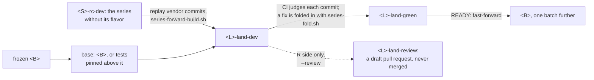

# Landing a series on its branch

*Handbook: [`operations/releases/process/`](/handbook/operations/releases/process/README.md),
the release process, of which a landing is how a canonical branch takes vendored commits.*

Every canonical branch that carries an engine takes it from its own series, a batch at a time,
by **fast-forwarding onto that series' vendor commits**:
every upstream commit the series vendored since the branch's last landing, with the R-side fix CI demanded folded into it,
replayed without the flavor onto the branch itself and judged by CI one by one,
and then the version bump written by hand, the landing's last commit (step 3).
Nothing else reaches the branch:
no flavor, no seed, and no port, because everything a port carries is the branch's already.

* **`main`'s own series onto `main`** is the routine case.
  `main` carries upstream `main`'s engine and releases nothing, so it lands whenever a batch is worth it,
  with no upstream release to wait for, and the bump takes the fourth component one up.
* **A line's series onto its release branch**, `v2.0-cyanoptera`, is the same procedure with `--onto` naming the branch:
  short of an upstream patch release the bump takes the fourth component one up, and with one it takes the release.
* **Changing the line CRAN ships**, when upstream releases the line `main` previewed, is the rarer case:
  a release branch is cut from `main` first, and the landing goes onto it
  ([Changing the line CRAN ships](#changing-the-line-cran-ships)).

The landings come often and stay small, so a rewind is rare:
the series is forwarded onto a branch that already vendors what the previous landing brought
([`series-forward`](/.claude/skills/series-forward/SKILL.md)).

`<S>` is the series that lands, its live forward while one exists, because that is the one standing on today's branch;
`<L>` is its line, `<S>` without `-fwd`, which names the landing's refs: `main` for `main`'s series, `v2.0-cyanoptera` for v2.0's.
`<B>` is the canonical branch it lands on, `main` or the line's release branch,
and `<v>` the version the bump sets ([`operations/releases/versioning/`](/handbook/operations/releases/versioning/README.md)).

## The refs



* **`<L>-land-dev`**, in the fork: `<B>` plus the vendor commits and, last, the version bump, and nothing else.
  CI judges it like any `-dev` ([`scripts/each-plan.sh`](/scripts/each-plan.sh)).
* **`<L>-land-green`**, in the fork: where CI's judgement starts.
  It is pushed at the frozen `<B>` and advanced over the commits that passed;
  the landing is ready when it equals `<L>-land-dev`, the bump included.

* **`<L>-land-review`**, in the canonical repository: the same landing without its engine,
  for a draft pull request that is read and never merged (step 4).

There is no `<L>-land-build`, so the loop never mistakes the pair for a series.
One landing per line is in flight at a time, and all three are deleted once `<B>` has taken it.

## Before you start

* **The series is current.**
  `<S>` has taken every port of `main`, and its rc strand is aligned
  ([`series-rc`](/.claude/skills/series-rc/SKILL.md)); the build refuses an rc strand behind its source,
  and its tree check refuses a series that lacks something `main` has.
* **The convergence findings are settled**, when `<S>` is a forward
  ([`series-forward`](/.claude/skills/series-forward/SKILL.md), `scripts/series-converge.sh <L>`).
  The landing carries the forward's tree, so whatever the forward lost against its base is lost on `<B>` too.
* **The series stands on `<B>`.**
  `<S>`'s seed is `<B>` as some earlier landing left it, and every port of `<B>` since is on it;
  a series seeded from another branch lands nothing the build can check.
  The replay starts above the vendor commit naming the engine `<B>` already vendors,
  so a series not forwarded since the previous landing lands only what came after it.

## 1. Freeze `<B>`

Every commit of the landing stands on one `<B>` commit, so `<B>` must not move until it fast-forwards.
The freeze lasts as long as CI takes over the batch, which is what keeps the batches small.
A ruleset with no bypass list stops every update, pull requests and admins included.
A human runs these, and reads each output before the next.

Inspect: the rulesets on `<B>`, and the commit it freezes at.

```sh
R=duckdb/duckdb-r B=<B>
gh api repos/$R/rulesets --jq '.[] | [.id, .name, .enforcement] | @tsv'
gh api repos/$R/commits/$B --jq .sha
```

Freeze:

```sh
B=<B>
gh api -X POST repos/duckdb/duckdb-r/rulesets --input - <<EOF
{
  "name": "freeze $B",
  "target": "branch",
  "enforcement": "active",
  "bypass_actors": [],
  "conditions": {"ref_name": {"include": ["refs/heads/$B"], "exclude": []}},
  "rules": [
    {"type": "update", "parameters": {"update_allows_fetch_and_merge": false}},
    {"type": "deletion"},
    {"type": "non_fast_forward"}
  ]
}
EOF
```

Verify: an `update` row from the new ruleset, and `never`.

```sh
B=<B>
gh api repos/duckdb/duckdb-r/rules/branches/$B --jq '.[] | [.type, .ruleset_id] | @tsv'
id=$(gh api repos/duckdb/duckdb-r/rulesets --jq ".[] | select(.name == \"freeze $B\") | .id")
gh api repos/duckdb/duckdb-r/rulesets/$id --jq .current_user_can_bypass
```

The loop keeps running: it reads `<B>` and writes no ref there.

## 2. Write down what the batch ends at

The landing goes up to the tip of `<S>-rc-dev` as it stands when the build starts.
Read off the engine it vendors and the engine `<B>` vendors, for the `NEWS.md` bullet the bump writes (step 3):

```sh
git fetch origin <S>-rc-dev && git fetch upstream <B>
git log -1 --format=%s origin/<S>-rc-dev -- src/duckdb   # its subject names duckdb/duckdb@<sha>
git log -1 --format=%s upstream/<B> -- src/duckdb        # the previous landing's engine
git -C "$UPSTREAM_CLONE" log -1 --format='%H %cs' <sha>  # the full SHA and its date
```

## 3. Build the landing

```sh
scripts/series-land.sh <S> --onto <B> --remote origin --canonical upstream          # build and check
scripts/series-land.sh <S> --onto <B> --remote origin --canonical upstream --push   # and write both refs
```

`--onto` defaults to `main`, so `main`'s own series needs none.

**Tests that pin what the line must keep go underneath, not into the series afterwards.**
A pull request of tests written on `<B>`'s engine, one commit on the frozen `<B>`,
is the landing's base: `--base <its branch>`.
Its commit lands with the vendor commits, CI judges it from `<B>` up,
and the tree check expects it merged into the series' package,
so the series has to carry it too before the landing can pass:
port it by name, `scripts/series-port.sh <S> --apply <sha>`.

[`scripts/series-land.sh`](/scripts/series-land.sh) replays with
[`scripts/series-forward-build.sh`](/scripts/series-forward-build.sh) in a worktree it keeps,
so everything that script stops on stops here, and a rerun resumes:

* **a conflict**: resolve it in the kept worktree the way the series resolved it, `git add`, rerun.
  rerere records the resolution, and a rebuild that meets the same conflict continues on its own;
* **a commit that vendors nothing and is not `<B>`'s**: decide where its change belongs and pass `--placed <sha>`.
  Ports of commits `<B>` already has are placed by their `-x` trailer, and tooling syncs by their subject;
* **the glue gate**: fix the glue in the commit that broke it and rerun.

The build ends with the tree check:
the landing's tip must be the package the rc strand holds,
except for `NEWS.md` and the READMEs, which are `<B>`'s by construction.
Anything else is something `<B>` has and the series lacks, or the other way round.
Fix it on the series and realign its rc strand; a rerun follows the strand from where the build stands.
Nothing is pushed until the check passes.
Two things the check cannot see are reported beside it:

* **files the landing deletes from `<B>`** outside the vendored strand and the tests, which the series lacks too.
  Each is a file the series lost on the way; restore it on the series before pushing.
* **resolutions rerere replayed**, named when the check fails.
  A wrong one is replayed as faithfully as a right one:
  rebuild with `--abort` and then `--attended`, which stops at every conflict with rerere's answer unstaged,
  and drop the wrong one there with `git rerere forget <path>`.

**The tests are held to the base's, and the push waits for them.**
The tree check compares the landing with the series, so a test the series stopped running passes it.
[`scripts/series-tests.sh`](/scripts/series-tests.sh) compares the landing's tests with its base's,
the frozen `<B>` and any tests pinned above it,
and the build refuses to push while one is lost:
a deleted file, block or snapshot entry, a skip the base does not make, or an engine gate, live or expired.
Restore each on the series in the vendor commit that took it, or take a gate out at the commit whose engine it names,
then realign the rc strand and rerun ([`operations/vendoring/series-loop/`](/handbook/operations/vendoring/series-loop/README.md)).
What a test expects may differ, and the report lists every such path with the commits that moved it,
marking one that a rewind changed and nothing put back.
A test that `<B>`'s engine passes and the batch's cannot is not the landing's to decide:
it is adapted in the base, written to hold on both engines, and ported to the series like any pinned test.

Committer dates are pinned to the frozen `<B>`'s, so a rebuild from the same inputs mints the same SHAs
and CI does not judge a commit twice.

**The version bump is the landing's last commit.**
[`operations/releases/versioning/`](/handbook/operations/releases/versioning/README.md) owns how it is written and which version `<v>` it sets:
the fourth component one above `<B>`'s, `2.0.99.9000` to `2.0.99.9001` on `main`,
or the release's three components where the batch brings an upstream release.
The build ends on the series' version, five components;
once it is pushed, add the bump in its kept worktree and push it onto `<L>-land-dev`, a plain fast-forward:

* **`DESCRIPTION`**: set `Version:` to `<v>`; the fifth component, the vendor counter, is dropped.
* **`NEWS.md`**: close the open section, turning its heading into `# duckdb <v>`,
  or write that section above the newest one where no pull request opened it.
  Its first bullet names the engine as the versioning page spells it, with the two SHAs step 2 wrote down,
  and anything else the batch changes that users of the package notice joins the bullets the pull requests wrote, leaving out the tooling.
* **The commit**: `chore: Bump version to <v>`.
  `scripts/series-land.sh` accepts that subject as the one commit above the vendor commits that changes only `NEWS.md` and the `Version:` line,
  with nothing above it, and refuses one whose version does not rise above `<B>`'s,
  or whose `NEWS.md` does not start with the version's section or still has an open one;
  `--status` prints `READY` only on a landing that ends on it.

CI judges the bump like every other commit.
A rebuild drops it, so after one, add it again.

## 4. Open the R side for review

The landing's own diff is the engine's, hundreds of thousands of lines.
What changes for `<B>`'s maintainers is the rest: the glue, R code and tests the series changed on the way.

```sh
scripts/series-land.sh <S> --onto <B> --remote origin --canonical upstream --review --push
gh pr create --repo duckdb/duckdb-r --draft --base <B> --head <L>-land-review \
  --title "Review: the R side of the <L> landing"
```

The run prints the build's test report as well; it belongs in the pull request's description,
because it is the one place a reviewer reads every test change the landing makes at once.

`<L>-land-review` is the frozen `<B>`, one commit that removes every workflow,
and one commit for each landing commit that changes anything outside the vendored strand,
carrying that change alone under the upstream commit that asked for it.
Its checks could only fail, because the R side compiles against no engine there,
and without workflow files the pull request starts nothing that builds or tests it.
It is never merged: a finding is fixed on the series, the landing is rebuilt,
and `--review --push` rewrites the branch, which the pull request follows.

**Findings converge in iterations before the series takes them.**
An iteration is a landing branch of its own, `<L>-land-v<n>`, with no `-dev` suffix so nothing builds it,
made from the previous one by folding each fix into the landing commit that introduced the defect,
so that every commit from there on carries it and every intermediate commit passes;
nothing is stacked on top of the vendor commits.
A fix is written as a commit on the commit it folds into,
and [`scripts/series-fold.sh`](/scripts/series-fold.sh) folds it there and replays everything above,
adding a note to the folded commit's message.
It is checked by the glue gate at every commit it changed and by building its tip and running the suite.
Each gets a review pull request of its own,
`--review --landing <L>-land-v<n> --suffix -v<n>`,
read by a reviewer with a clean context;
the next iteration answers what that review found, until a review finds nothing.
The fixes then go onto the series, and the landing is built from it as above.

## 5. Let CI judge every commit

Pushing `<L>-land-dev` starts the per-commit build over `<L>-land-green..<L>-land-dev`.
Read and advance it with

```sh
scripts/series-land.sh <S> --onto <B> --status --push
```

which moves `<L>-land-green` over the commits that passed and names the first that has not.
A red is repaired as stage 2 repairs one ([`series-loop`](/.claude/skills/series-loop/SKILL.md)):

* **the infrastructure's fault**: push `retry-<L>-land-dev` at the commit, once;
* **the tree's fault**: fix it on the series, as stage 2 would, and realign its rc strand.
  In the kept worktree, `git reset --hard` to the parent of the red commit,
  then rerun the build: it follows the realigned strand and replays from there,
  so the landing never carries a fix the series does not.
* **the bump's**: amend it and force-push `<L>-land-dev`; `<L>-land-green` stays at the last vendor commit.

## 6. Fast-forward `<B>`

When `--status` prints `READY`, every commit has passed and `<B>` is still the commit the landing stands on.
Push the SHA that line names, not whatever the branch holds by then,
so a repair pushed in between cannot reach `<B>` unjudged.
Lift the freeze, push, put the freeze back, and then tag the bump:

```sh
B=<B> sha=<the SHA the READY line names>
id=$(gh api repos/duckdb/duckdb-r/rulesets --jq ".[] | select(.name == \"freeze $B\") | .id")
gh api -X PUT repos/duckdb/duckdb-r/rulesets/$id -f enforcement=disabled
git push upstream $sha:refs/heads/$B
gh api -X PUT repos/duckdb/duckdb-r/rulesets/$id -f enforcement=active
git ls-remote upstream refs/heads/$B
```

The push is a plain one, so git refuses it unless it is a fast-forward.
It needs the existing branch ruleset's admin bypass, because it is not a pull request.

Then tag the bump, which is the commit `READY` named, as every landing's bump is tagged
([`operations/releases/versioning/`](/handbook/operations/releases/versioning/README.md));
the freeze ruleset targets the branch only, so the tag needs no lifted freeze.
It is annotated the way `cran-submission.yaml` annotates the release tags: the subject `duckdb <v>`, then the `NEWS.md` section as body.
A bump to an upstream release is tagged by the CRAN submission instead ([`operations/releases/cran/`](/handbook/operations/releases/cran/README.md)).

```sh
v=<v>
{ printf 'duckdb %s\n\n' "$v"; git show "$sha:NEWS.md" | awk -v h="# duckdb $v" '$0 == h {f = 1; next} /^# duckdb / {f = 0} f'; } > tag-message
[ "$(grep -c . tag-message)" -gt 1 ] || { echo "no NEWS.md section for $v" >&2; false; }
git tag -a "v$v" --cleanup=whitespace -F tag-message "$sha"
git push upstream "refs/tags/v$v"
```

## 7. After the landing

Delete the freeze, so that `<B>` takes pull requests again:

```sh
B=<B>
id=$(gh api repos/duckdb/duckdb-r/rulesets --jq ".[] | select(.name == \"freeze $B\") | .id")
gh api -X DELETE repos/duckdb/duckdb-r/rulesets/$id
```

Then the series:

* **Delete the landing**: `<L>-land-dev` and `<L>-land-green` on the fork,
  `<L>-land-review` in the canonical repository with its draft pull request closed,
  and the kept worktree with `scripts/series-land.sh <S> --abort`.
* **Forward the series onto the new `<B>` when its drift is worth it**
  ([`series-forward`](/.claude/skills/series-forward/SKILL.md)).
  The new seed already vendors what the landing vendored, so the forward replays only what came after, and opens on no rewind.
  Until then the next landing is built from the same series, and replays only what this one did not land.

## Changing the line CRAN ships

When upstream releases the line `main`'s series has been previewing, CRAN moves to it,
and the line it shipped before keeps its release branch, parked.
`<N>` is the new line, upstream's new release branch, with a series of its own since upstream cut it
([`series-open`](/.claude/skills/series-open/SKILL.md)); `<P>` is the line CRAN ships until then, `v2.0-cyanoptera`.

1. **Cut `<N>` in `duckdb/duckdb-r` from `main`**, whose R side and tooling the new line keeps.
   Inspect, cut, confirm, each read before the next:

   ```sh
   git fetch upstream main
   git ls-remote upstream refs/heads/<N>      # nothing yet
   git log -1 --format='%h %s' upstream/main -- src/duckdb
   ```

   ```sh
   git push upstream upstream/main:refs/heads/<N>
   ```

   ```sh
   git ls-remote upstream refs/heads/<N> refs/heads/main
   ```

2. **Declare it**, in one pull request on `main` before the landing:
   in [`scripts/series.yaml`](/scripts/series.yaml) the CRAN flavor's `upstream` and `publishes_from` become `<N>`,
   the `<N>` series' `releases_from` becomes `<N>`, and `<P>`'s keeps `<P>`;
   then `.github/pull.yml` from `scripts/pull-config.sh` and the tables from `scripts/series-table.R`,
   checked with `--check` ([`branches/mirrors/`](/handbook/branches/mirrors/README.md)).
3. **Land `<N>`'s series onto `<N>`**, steps 1 to 7 with `<B>` = `<N>`, ending on the bump to its first release, or short of it to `<N>`'s fourth component one up.
   Where `main` had landed past the fork point, the first pick vendors an older engine than the branch, and the build takes its strand whole.
4. **`main` previews the next line from here**:
   its next landing's bump takes the new prefix, `2.1.99.9001` once 2.1 is out
   ([`operations/releases/versioning/`](/handbook/operations/releases/versioning/README.md)).
   A fix `<P>` still takes reaches `main` only where `main` still needs it, by cherry-pick; it is no longer reported as owed.
