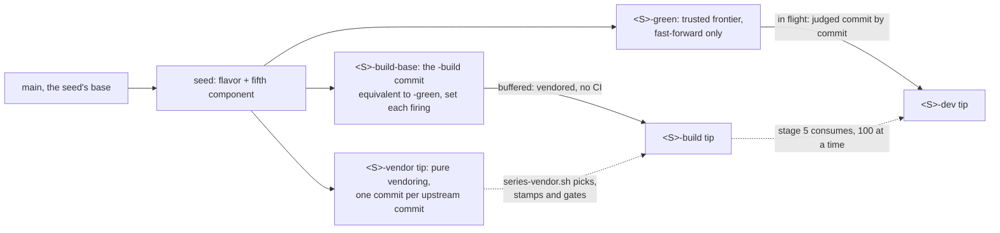
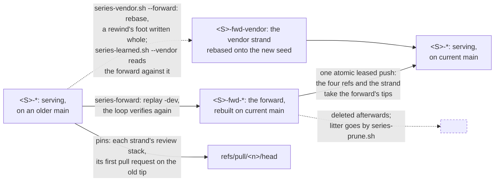

# The model

The series and their refs: what a series is, where its branches live,
what each ref means and how far it may move.
[`BRANCHES.md`](/BRANCHES.md) keeps what is not yet absorbed:
the package components and the repository diagrams.

**A series** is one upstream branch of `duckdb/duckdb` —
`main`, `v1.5-variegata`, `v1.4-andium` —
together with the R package branches that carry it.
A series is *discovered, not configured*:
the vendoring routine serves every `<S>-build` ref that has a
sibling `<S>-dev`, so opening one is creating refs
([`.claude/skills/series-open/SKILL.md`](/.claude/skills/series-open/SKILL.md)).

**Two repositories.**
`duckdb/duckdb-r` is canonical:
`main`, the release branch of the line CRAN ships, the stale baselines awaiting retirement, the LTS flavor branch;
CRAN and the numbered r-universe packages publish from here.
`main` carries the engine of upstream `main` and makes no CRAN release;
the line CRAN ships has a branch of its own, named as upstream names it, `v2.0-cyanoptera`, from which its releases are cut
([`operations/releases/process/`](/handbook/operations/releases/process/README.md)).
Plain `duckdb` on r-universe is built from `main` all the same, by decision, so r-universe shows the next line and CRAN the current one:
that is why the flavor table names `main` as where `duckdb` is published from
([`flavors/`](/handbook/branches/flavors/README.md)).
**Until the switch, part of the layout before it holds.**
`v2.0-cyanoptera` exists in `duckdb/duckdb-r`, cut from `main` at `e913ab08fd`.
The rest of the layout takes effect once `scripts/series.yaml` names it as the v2.0 series' `releases_from`
([#2991](https://github.com/duckdb/duckdb-r/pull/2991)).
Until then the v2.0 series still releases from `main`:
`scripts/series-port.sh` ports `main`'s R side into it, `scripts/series-land.sh --target` names `main` for it, and it seeds on `main`;
and `main` still carries the 2.0 engine at `2.0.0.9000`, so it takes no landing of upstream `main` and no forward merge yet.
`main` stays at `2.0.0.9000` until the first landing of its own series, whose bump is `2.0.99.9000`
([`versioning/`](/handbook/operations/releases/versioning/README.md)).
FORWARD-PORT in `scripts/series-check.sh` already reads `v2.0-cyanoptera`, the CRAN row's `upstream`,
so it lists what lands there before the v2.0 series releases from it.
The pages describing the two-branch layout link here for that.
`krlmlr/duckdb-r` is a fork of it — a fork object in the same fork
network, not a copy that shares its name — used for CI/CD
so the per-commit builds do not consume
the `duckdb` organization's Actions quota;
every series' working refs live there,
beside mirrors of the canonical branches
they are seeded from and measured against
([`mirrors/`](/handbook/branches/mirrors/README.md)).
The fork carries only the refs the loop serves;
what it does not carry stands in `krlmlr/duckdb-r-old`,
an archive that nothing reads and nothing writes to.
The `<S>-dev-base` refs of the older `dev`/`dev-base` layout are there:
every series is a series-loop series now, and none of the four below is that baseline.

**The four refs** of a series `<S>`, all in the fork, and the vendor strand they are derived from:

| Ref | Moves by | Meaning |
|---|---|---|
| `<S>-build` | append; force-push to repair | the buffer: one commit per upstream commit, glue compiling, no CI |
| `<S>-dev` | append; force-push | what CI judges commit by commit, and what r-universe builds; `-build` consumed in bounded chunks plus forward-ports from `main` |
| `<S>-green` | fast-forward only | the trusted frontier — every commit behind it has a successful run; what the per-commit planner and the cutover gate measure from |
| `<S>-build-base` | set; force-push | the `-build` commit equivalent to `-green` |
| `<S>-vendor` | append; force-push to amend a patch | the **vendor strand**: pure vendoring, one commit per upstream commit, vendored once; what the buffer is derived from, and what a forward carries by a rebase. No CI, nothing publishes it |

The vendor strand is what vendoring alone produces.
[`vendor-one.sh --strand`](/scripts/vendor-one.sh) writes one commit per upstream commit onto `<S>-vendor`:
the regenerated tree with the patch stack applied and the files generated from it, never the counter and never the glue.
`<S>-build` is derived from it commit by commit ([`scripts/series-vendor.sh`](/scripts/series-vendor.sh)):
the strand commit cherry-picked, the fifth component stamped, the glue gate run,
so a glue fix is the buffer's own and the two share the vendored tree at every twin.
Each upstream commit is vendored once.
A forward carries the strand onto its seed by a plain rebase, each commit a `git apply` of a pure vendoring diff,
where the seed vendors an engine the strand has;
where it does not, a rewind, the strand's first commit is written on the seed whole and the rest cherry-picked above it.
What `<S>-fwd-build` carries beyond the strand is what `-dev` taught, now on the new base,
and [`scripts/series-learned.sh`](/scripts/series-learned.sh) `--vendor` prints it commit by commit,
for a human to judge before the loop verifies the forward and to answer with a correction to `<S>-fwd-build`
([`series-forward`](/.claude/skills/series-forward/SKILL.md)).
A `patch/` entry belongs to the strand, since the tree it is applied to does, so a patch fix amends the strand commit and is picked again;
[`scripts/series-check.sh`](/scripts/series-check.sh) says when the buffer and the strand are out of step.
A series opened before the strand existed derives one from its buffer once, with nothing re-vendored.
No CI runs on it, nothing publishes it, and it is not mirrored;
a cutover swaps it with the four, and pins the replaced lineage like theirs.

The refs of one series, as the loop moves them; the `-dev` line below green is what CI has passed,
above it what is in flight, and the buffer runs ahead of both:



A series, its forward and the forward's vendor strand, and what a cutover does with them;
r-universe builds `<S>-green` throughout, and the names never change:



All four exist from a series' first day, so there is never a "no green yet" state.
An opening cuts the parent's strands at the fork point and writes all four there
([`series-open`](/.claude/skills/series-open/SKILL.md)).
A green records that CI passed on a commit, and here it did: the cut moves no
commit, so `<S>-dev`'s tip *is* the parent's, same tree and same run.
That is what makes the green honest — not inheritance, but the absence of any
change to inherit across.

**A new-born green never takes the flavor commits.**
An opening's reflavor lands above the cut, and a forward, or a rebase of one,
writes a new seed: the flavor pair and the fifth-component commit, on `main` or
on the release branch the series was seeded from. None of those commits has a
run, so `<S>-green` starts below them, at the cut or at the commit the seed sits
on, and `<S>-dev` above them.
CI judges the flavor commits like any other, and green crosses them when they pass.
Under green they would never be judged, and could not be repaired either:
the loop re-examines nothing at or before green, and green only fast-forwards.
A flavor commit can need one: `v1.5-variegata-fwd` was seeded with a
`src/cpp11.dd` still naming the unflavored types header (2026-09-28).

The buffer is deliberately untested on CI/CD,
so vendoring can run ahead while CI catches up
([`ci/per-commit/selection/`](/handbook/operations/ci/per-commit/selection/README.md)).

**Untested is a property of the tooling on the ref, not of the ref's name.**
A workflow fires from the branch it sits on,
so what keeps the buffer quiet is that the workflows it carries
match no branch it is called —
and a buffer carrying the copies it was seeded with
is judged by that day's filters instead.
`v1.4-andium-build` was: a 2026-03-26 `R-CMD-check.yaml`
whose release pattern matches the buffer's own name
put an `rcc` status on a commit no per-commit leg had decided.
So the port stage syncs the buffer's tooling too
([`operations/vendoring/series-loop/`](/handbook/operations/vendoring/series-loop/README.md)),
and the model's "no CI" holds because something maintains it.
Rebasing a series happens *beside* it as a `<S>-fwd` counterpart, one at a time,
verified from scratch and swapped in by a **cutover** the maintainer signs off
([`series-forward`](/.claude/skills/series-forward/SKILL.md)),
run by a session he sends ([`series-cutover`](/.claude/skills/series-cutover/SKILL.md));
a serving `-green` never moves sideways on its own.
The names are static, so nothing outside the two repositories learns of a cutover.
What the swap replaces is read and kept first, in the fork, as a **review stack** per strand `<X>`,
whose layers [`scripts/series-cutover-stack.sh`](/scripts/series-cutover-stack.sh) lists in its header,
each a draft pull request into the one below.
The first, `cutover/<S>/<X>/1-main`, stands on the old tip `<S>-<X>`, and its head is a **pin**:
GitHub keeps it reachable as `refs/pull/<n>/head` for as long as the pull request exists, closed or not,
and the swap refuses to move a ref no pin holds,
of `<S>-dev`, `<S>-build`, `<S>-vendor`, `<S>-green` and `<S>-build-base`,
and the canonical repository's copy of `<S>-green` unless it is the fork's green.
The **cutover pull request**, an empty draft from `cutover/<S>/pr` into the fork's `main`,
carries the report, the stacks' review and the sign-off, and is closed, never merged.
The `-fwd` refs go afterwards, their tips being the series' refs by then,
and what a refused deletion leaves is **cutover litter**, listed by the cutover itself and by
[`scripts/series-prune.sh`](/scripts/series-prune.sh) for a human to remove.
**`<S>-rc-dev` is the series without its flavor**, one commit for each commit of `<S>-dev`,
so that the package a release ships as plain `duckdb` has verdicts of its own.
It is one ref: no buffer, since it is derived rather than vendored,
and no `-green` or `-build-base`, since nothing publishes it.
CI judges it from its own seed up, and the loop realigns it rather than serving it
([`series-rc`](/.claude/skills/series-rc/SKILL.md)).
**`<S>-alpha` is a green commit stamped with the version of upstream's alpha build of its engine**,
and `<S>-rc-alpha` the same stamp on its rc twin,
because upstream publishes extensions under that version and never under the commit a `-dev` stamp looks in.
Each is one commit on a verified one, moved by the loop when a newer alpha appears
([`series-alpha`](/.claude/skills/series-alpha/SKILL.md)).
**`<L>-land-dev` is a batch of a series on its way onto the canonical branch it lands on**:
the frozen branch plus the series' vendor commits, unflavored, and a hand-written version bump,
which the branch fast-forwards onto once CI has passed every one.
`<L>` is the series' line, so `main`'s own series lands as `main-land-dev` onto `main`,
and the v2.0 series as `v2.0-cyanoptera-land-dev` onto `v2.0-cyanoptera`; one landing per line is in flight at a time.
`<L>-land-green` marks how far CI has passed it, starting at the frozen branch.
The pair exists only while a landing is in flight, and has no buffer, so the loop never serves it.
`<L>-land-review`, in the canonical repository, is the landing without its engine,
which a draft pull request shows for review and never merges
([`series-land`](/.claude/skills/series-land/SKILL.md)).
**`retry-<S>-dev` is the rerun ledger**: pushed at one commit of `<S>-dev` to have it judged again on its own SHA,
one per series, and never deleted while its series serves; a forward's goes with the forward's refs at the cutover
([`series-loop`](/.claude/skills/series-loop/SKILL.md), *Rerun one commit*).
**The badges in the root [`README.md`](/README.md) count the gaps between these refs**,
and both counts stay linear by construction —
`-green` is always an ancestor of `-dev`, and `-build-base` of `-build`:

* **in flight** — pushed to CI, not yet trusted: `<S>-green..<S>-dev`
* **buffered** — vendored, not yet consumed: `<S>-build-base..<S>-build`
* **ahead** — against the branch the series releases from

`-build-base` is a display ref and exists for exactly this; no script reads it back.
shields.io renders a count from the public repository:

```text
https://img.shields.io/github/commits-difference/krlmlr/duckdb-r?base=<S>-green&head=<S>-dev&label=in%20flight
```

It compares **within one repository**, which is what forces every ref a badge names
to live in `krlmlr/duckdb-r`, release branches included, and kept fresh
([`branches/mirrors/`](/handbook/branches/mirrors/README.md)).
Link each badge to `https://github.com/krlmlr/duckdb-r/compare/<base>...<head>`, its drill-down.
An upstream-lag badge — how far behind `duckdb/duckdb` itself — is not expressible this way,
because that comparison crosses repositories.
The table's upkeep is [`series-open`](/.claude/skills/series-open/SKILL.md)'s.

**The canonical branches of `duckdb/duckdb-r` are the source of truth** for four of the seven components
a branch is made of, and the other three come from elsewhere:

| Component | Source of truth | |
|---|---|---|
| DuckDB core | `duckdb/duckdb` upstream | vendored independently into each series |
| Flavor | per branch, via [`flavor.sh`](/scripts/flavor.sh) | applied mechanically on top of the baseline |
| **Glue code** | **the oldest active release branch, merged forward to `main`** | ported to each series from the branch it releases from |
| **R code and tests** | **the oldest active release branch, merged forward to `main`** | ported to each series from the branch it releases from |
| **CI/CD infrastructure** | **`main`** | forward-ported to every series |
| **cpp11** | **`main`** | forward-ported to every series |
| R core | external — `r-devel`, CRAN policy | monitored; fixes land on the oldest active release branch first |

**At most three lines are active, and CRAN follows the middle one once there are three.**
`main` previews the next line, v2.1 today, while `v2.0-cyanoptera` serves the line CRAN ships.
When upstream cuts a release branch for the line `main` previews, `vX.Y-<name>`, we cut ours from `main` the same day
([`series-land`](/.claude/skills/series-land/SKILL.md), "Changing the line CRAN ships"),
and `main` moves on to preview the line after it.
That makes three: the oldest line, the new release branch, and `main`;
CRAN moves to the new line, the middle one, with its first release,
and the older lines retire as a newer one takes over, so that no more than three are active at a time,
as [the plan for the cycle](https://github.com/duckdb/duckdb-r/pull/2987#issuecomment-6896640798) lays out.
A fix still starts on the oldest active line and is merged forward through each newer one.
A line no longer active is **stale** until it is retired:
its series is declared `stale: true` in [`scripts/series.yaml`](/scripts/series.yaml) and takes no R-side ports,
which v1.4 and v1.5 are today.

**Forward-porting runs from the branch a series releases from**:
each `<S>-dev` takes that branch's R-side commits, on every firing,
by [`series-port.sh`](/scripts/series-port.sh), the loop's port stage
([`operations/vendoring/series-loop/`](/handbook/operations/vendoring/series-loop/README.md)):
`main`'s for `main`'s own series, and the line's release branch's for a line that has one.
Tooling comes from `main` for every series, no series ports from another,
and a line declared `stale: true` in [`scripts/series.yaml`](/scripts/series.yaml) takes the tooling sync alone.

**An R-side fix is written on the oldest active release branch and merged forward.**
A fix goes to the oldest line it applies to, as a pull request against that line's release branch, `v2.0-cyanoptera` today,
and reaches every newer line by merging the older branch into the next newer one:
`v2.0-cyanoptera` into `main` today, and with three lines `v2.0` into `v2.1` and `v2.1` into `main`.
A fix only a newer line needs is written on that line directly,
and a fix written on a newer line first and then found to be needed on an older one is picked back with `git cherry-pick -x`.
Tooling is `main`'s alone, and reaches a release branch only as such a pick.
This turns the R-package convention around, where `main` is roughly what CRAN has:
here `main` is the newest line, and CRAN's is an older release branch.
It is deliberate: a fix written once on the oldest line and merged forward is built and checked once per line,
where the same fix cherry-picked into every line repeats the CI work for little extra value,
and the branches follow upstream's, one per line.

**A forward merge keeps the newer line's engine.**
It is an ordinary merge, made as a pull request and merged with "Create a merge commit", never squashed or rebased.
A landing on the older branch brings that line's vendor commits, which the newer line must not take,
so the merge keeps the newer side of the vendored strand and what is generated from it,
`series_strand` and `series_makevars` in [`scripts/series-config.sh`](/scripts/series-config.sh),
the `DESCRIPTION` merge driver keeps its version and engine record,
and the `NEWS.md` merge driver orders both lines' sections newest version first
([`operations/releases/versioning/`](/handbook/operations/releases/versioning/README.md)).
[`series-land`](/.claude/skills/series-land/SKILL.md) has the commands,
and [`scripts/series-check.sh`](/scripts/series-check.sh) lists for each active release branch what is not yet merged forward,
counting its vendor commits and version bumps and listing each R-side commit.
A path-limited walk of the engine follows a forward merge's first parent by itself, since the merge keeps that side of the engine,
and the port stage walks the newer line's first parents, offering each forward merge as one port of its change outside the engine,
so the commits behind it, the older line's vendor commits and fixes, never reach the newer line's series one by one.
The fork's `main` takes no part in it: it is a mirror and moves on its own
([`mirrors/`](/handbook/branches/mirrors/README.md)).

That ordering is what makes the vendor strand the only thing a series owns.
Everything else it carries was born on the branch it releases from and arrived by port,
which is why a regenerated seed is allowed to replace a series' whole R side
and why a replay takes the new base for everything the vendor commits do not touch
([`series-forward`](/.claude/skills/series-forward/SKILL.md)).
The vendor commits themselves a forward takes from `<S>-dev`, fixes folded in,
so a forward commit's tree is the verified tree plus `main`'s delta,
and `<S>-build` supplies only what `<S>-dev` has not consumed yet.

*To deepen: absorb `BRANCHES.md` §§ Package Components and Branch Overview.*
