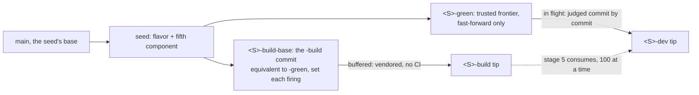
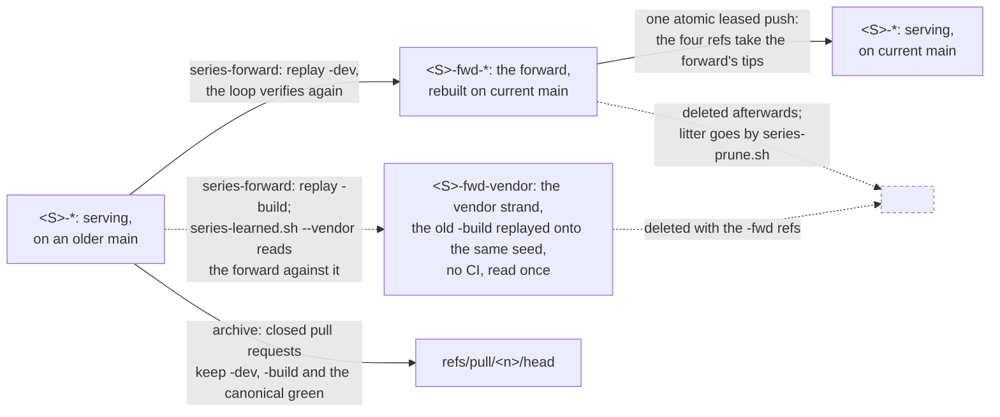

# The model

The series and their refs: what a series is, where its branches live,
what each ref means and how far it may move.
[`BRANCHES.md`](/BRANCHES.md) keeps what is not yet absorbed:
the package components and the repository diagrams.

**A series** is one upstream branch of `duckdb/duckdb` —
`main`, `v1.5-variegata`, `v1.4-andium` —
together with the R package branches that carry it.
A series is *discovered, not configured*:
the vendoring routine serves every `<S>-build` ref that has a
sibling `<S>-dev`, so opening one is creating refs
([`.claude/skills/series-open/SKILL.md`](/.claude/skills/series-open/SKILL.md)).

**Two repositories.**
`duckdb/duckdb-r` is canonical:
`main`, the parked stable baselines, the LTS flavor branch;
CRAN and the numbered r-universe packages publish from here.
`krlmlr/duckdb-r` is a fork of it — a fork object in the same fork
network, not a copy that shares its name — used for CI/CD
so the per-commit builds do not consume
the `duckdb` organization's Actions quota;
every series' working refs live there,
beside mirrors of the canonical branches
they are seeded from and measured against
([`mirrors/`](/handbook/branches/mirrors/README.md)).
The fork carries only the refs the loop serves;
what it does not carry stands in `krlmlr/duckdb-r-old`,
an archive that nothing reads and nothing writes to.
The `<S>-dev-base` refs of the older `dev`/`dev-base` layout are there:
every series is a series-loop series now, and none of the four below is that baseline.

**The four refs** of a series `<S>`, all in the fork:

| Ref | Moves by | Meaning |
|---|---|---|
| `<S>-build` | append; force-push to repair | the buffer: one commit per upstream commit, glue compiling, no CI |
| `<S>-dev` | append; force-push | what CI judges commit by commit, and what r-universe builds; `-build` consumed in bounded chunks plus forward-ports from `main` |
| `<S>-green` | fast-forward only | the trusted frontier — every commit behind it has a successful run; what the per-commit planner and the cutover gate measure from |
| `<S>-build-base` | set; force-push | the `-build` commit equivalent to `-green` |
| `<S>-fwd-vendor` | written once by the forward; force-push | the **vendor strand** of a forward: the old `-build` replayed onto the forward's seed, pure vendoring's diffs on the new base, no CI, nothing consumes it |

The vendor strand exists on a forward only, because only there do two readings of the same upstream commits stand side by side.
`<S>-build` is what pure vendoring produces plus the glue each engine needed to compile;
`<S>-dev` is the same commits with what CI demanded afterwards folded in,
and `<S>-fwd-build` is the replay of `-dev`, so the forward carries every one of those fixes,
the sound ones and the expedient ones alike.
`<S>-fwd-vendor` is the replay of `-build` onto the same seed:
what the forward would carry had it taken nothing from `-dev`,
and what a fresh vendoring of the same commits onto today's `main` would produce,
without the cost of one, which [`vendor-one.sh`](/scripts/vendor-one.sh) pays at about fifteen seconds per commit.
Its vendored strand equals `<S>-fwd-build`'s at every twin, by construction of the replay;
everything else that differs between the two is what `-dev` taught, now on the new base,
and [`scripts/series-learned.sh`](/scripts/series-learned.sh) `--vendor` prints it commit by commit,
for a human to judge before the loop verifies the forward and to answer with a correction to `<S>-fwd-build`
([`series-forward`](/.claude/skills/series-forward/SKILL.md)).
It is a buffer like `-build`: no CI runs on it, and nothing after the forward's opening reads it,
so it is deleted with the `-fwd` refs at the cutover, archived as a closed pull request's head like the rest.

The refs of one series, as the loop moves them; the `-dev` line below green is what CI has passed,
above it what is in flight, and the buffer runs ahead of both:



A series, its forward and the forward's vendor strand, and what a cutover does with them;
r-universe builds `<S>-green` throughout, and the names never change:



All four exist from a series' first day, so there is never a "no green yet" state.
An opening cuts the parent's strands at the fork point and writes all four there
([`series-open`](/.claude/skills/series-open/SKILL.md)).
A green records that CI passed on a commit, and here it did: the cut moves no
commit, so `<S>-dev`'s tip *is* the parent's, same tree and same run.
That is what makes the green honest — not inheritance, but the absence of any
change to inherit across.

**A new-born green never takes the flavor commits.**
An opening's reflavor lands above the cut, and a forward, or a rebase of one,
writes a new seed: the flavor pair and the fifth-component commit, on `main` or
on the release branch the series was seeded from. None of those commits has a
run, so `<S>-green` starts below them, at the cut or at the commit the seed sits
on, and `<S>-dev` above them.
CI judges the flavor commits like any other, and green crosses them when they pass.
Under green they would never be judged, and could not be repaired either:
the loop re-examines nothing at or before green, and green only fast-forwards.
A flavor commit can need one: `v1.5-variegata-fwd` was seeded with a
`src/cpp11.dd` still naming the unflavored types header (2026-09-28).

The buffer is deliberately untested on CI/CD,
so vendoring can run ahead while CI catches up
([`ci/per-commit/selection/`](/handbook/operations/ci/per-commit/selection/README.md)).

**Untested is a property of the tooling on the ref, not of the ref's name.**
A workflow fires from the branch it sits on,
so what keeps the buffer quiet is that the workflows it carries
match no branch it is called —
and a buffer carrying the copies it was seeded with
is judged by that day's filters instead.
`v1.4-andium-build` was: a 2026-03-26 `R-CMD-check.yaml`
whose release pattern matches the buffer's own name
put an `rcc` status on a commit no per-commit leg had decided.
So the port stage syncs the buffer's tooling too
([`operations/vendoring/series-loop/`](/handbook/operations/vendoring/series-loop/README.md)),
and the model's "no CI" holds because something maintains it.
Rebasing a series happens *beside* it as a `<S>-fwd` counterpart, one at a time,
verified from scratch and swapped in by a human-run **cutover**
([`series-forward`](/.claude/skills/series-forward/SKILL.md));
a serving `-green` never moves sideways on its own.
The names are static, so nothing outside the two repositories learns of a cutover,
and the lineages the swap replaces are kept first,
each as the head of a draft pull request opened and closed on the spot,
which GitHub keeps reachable as `refs/pull/<n>/head` for as long as it exists:
the fork's `<S>-dev` and `<S>-build`, and the canonical repository's copy of `<S>-green`.
The `-fwd` refs go afterwards, their tips being the series' refs by then,
and what a refused deletion leaves is **cutover litter**, listed by
[`scripts/series-prune.sh`](/scripts/series-prune.sh) for a human to remove.
**`<S>-rc-dev` is the series without its flavor**, one commit for each commit of `<S>-dev`,
so that the package a release ships as plain `duckdb` has verdicts of its own.
It is one ref: no buffer, since it is derived rather than vendored,
and no `-green` or `-build-base`, since nothing publishes it.
CI judges it from its own seed up, and the loop realigns it rather than serving it
([`series-rc`](/.claude/skills/series-rc/SKILL.md)).
**`<S>-alpha` is a green commit stamped with the version of upstream's alpha build of its engine**,
and `<S>-rc-alpha` the same stamp on its rc twin,
because upstream publishes extensions under that version and never under the commit a `-dev` stamp looks in.
Each is one commit on a verified one, moved by the loop when a newer alpha appears
([`series-alpha`](/.claude/skills/series-alpha/SKILL.md)).
**`<L>-land-dev` is a line on its way onto `main`**: the frozen `main` plus the series' vendor commits, unflavored,
which `main` fast-forwards onto once CI has passed every one.
`<L>-land-green` marks how far CI has passed it, starting at the frozen `main`.
The pair exists only while a landing is in flight, and has no buffer, so the loop never serves it.
`<L>-land-review`, in the canonical repository, is the landing without its engine,
which a draft pull request shows for review and never merges
([`series-land`](/.claude/skills/series-land/SKILL.md)).
**`retry-<S>-dev` is the rerun ledger**: pushed at one commit of `<S>-dev` to have it judged again on its own SHA,
one per series, and never deleted while its series serves; a forward's goes with the forward's refs at the cutover
([`series-loop`](/.claude/skills/series-loop/SKILL.md), *Rerun one commit*).
**The badges in the root [`README.md`](/README.md) count the gaps between these refs**,
and both counts stay linear by construction —
`-green` is always an ancestor of `-dev`, and `-build-base` of `-build`:

* **in flight** — pushed to CI, not yet trusted: `<S>-green..<S>-dev`
* **buffered** — vendored, not yet consumed: `<S>-build-base..<S>-build`
* **ahead** — against the branch the series releases from

`-build-base` is a display ref and exists for exactly this; no script reads it back.
shields.io renders a count from the public repository:

```text
https://img.shields.io/github/commits-difference/krlmlr/duckdb-r?base=<S>-green&head=<S>-dev&label=in%20flight
```

It compares **within one repository**, which is what forces every ref a badge names
to live in `krlmlr/duckdb-r`, release branches included, and kept fresh
([`branches/mirrors/`](/handbook/branches/mirrors/README.md)).
Link each badge to `https://github.com/krlmlr/duckdb-r/compare/<base>...<head>`, its drill-down.
An upstream-lag badge — how far behind `duckdb/duckdb` itself — is not expressible this way,
because that comparison crosses repositories.
The table's upkeep is [`series-open`](/.claude/skills/series-open/SKILL.md)'s.

**`main` in `duckdb/duckdb-r` is the source of truth** for four of the seven components
a branch is made of, and the other three come from elsewhere:

| Component | Source of truth | |
|---|---|---|
| DuckDB core | `duckdb/duckdb` upstream | vendored independently into each series |
| Flavor | per branch, via [`flavor.sh`](/scripts/flavor.sh) | applied mechanically on top of the baseline |
| **Glue code** | **`main`** | forward-ported to every series |
| **R code and tests** | **`main`** | forward-ported to every series |
| **CI/CD infrastructure** | **`main`** | forward-ported to every series |
| **cpp11** | **`main`** | forward-ported to every series |
| R core | external — `r-devel`, CRAN policy | monitored; fixes land in `main` first |

**Forward-porting runs from `main` to every series, and never in reverse**:
each `<S>-dev` takes `main`'s commits directly, on every firing,
by [`series-port.sh`](/scripts/series-port.sh), the loop's port stage
([`operations/vendoring/series-loop/`](/handbook/operations/vendoring/series-loop/README.md));
no series ports from another, and a parked line takes the tooling sync alone.
The fork's `main` takes no part in it: it is a mirror and moves on its own
([`mirrors/`](/handbook/branches/mirrors/README.md)).

That ordering is what makes the vendor strand the only thing a series owns.
Everything else it carries was born on `main` and arrived by port,
which is why a regenerated seed is allowed to replace a series' whole R side
and why a replay takes the new base for everything the vendor commits do not touch
([`series-forward`](/.claude/skills/series-forward/SKILL.md)).
The vendor commits themselves a forward takes from `<S>-dev`, fixes folded in,
so a forward commit's tree is the verified tree plus `main`'s delta,
and `<S>-build` supplies only what `<S>-dev` has not consumed yet.

*To deepen: absorb `BRANCHES.md` §§ Package Components and Branch Overview.*
