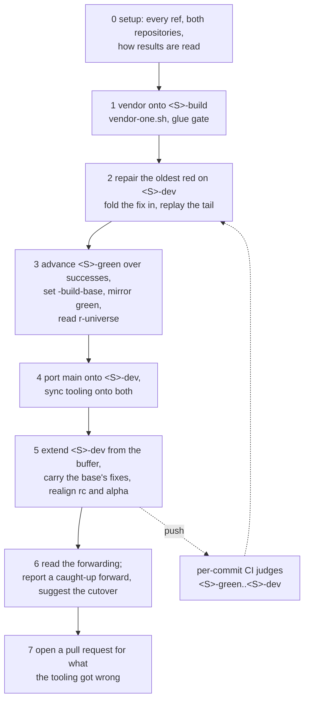

# The series loop

The scheduled routine that vendors every series.
The procedures are machine-loaded playbooks under
[`.claude/skills/`](/.claude/skills) —
[`series-loop/SKILL.md`](/.claude/skills/series-loop/SKILL.md) with its
siblings `series-forward`, `series-rebase`, `series-open`, `series-rc`, `series-alpha`, `series-land` —
linked from here, never restated:
a reader who wants to *run* the loop follows the link;
what runs is this page's topic.

The loop is a scheduled **agent routine**, not a workflow —
nothing under `.github/workflows/` starts it,
and its schedule lives with the routine, outside this tree.
A firing serves every series discovered from the refs
([`branches/model/`](/handbook/branches/model/README.md)).
Setup always runs; every stage after it is skipped when it has nothing
to do, and they run in this order:

* **Vendor onto `<S>-build`** — extend the buffer with `vendor-one.sh`,
  fixing glue where the gate stops;
  red never blocks the buffer.
* **Repair the oldest `<S>-dev` failure** — read each commit's verdict
  and log from the `each-rcc` run that decided it, falling back to the
  `rcc2` store when a run cannot be reached
  ([`ci/per-commit/contract/`](/handbook/operations/ci/per-commit/contract/README.md)),
  and classify by what a log positively contains:
  the tree's fault is folded into the
  offending commit and the tail replayed;
  the infrastructure's fault is retried once via a `retry-` ref
  that also serves as the ledger.
* **Advance the frontier, and read what r-universe made of the last one**
  — fast-forward `-green` over commits with recorded *successful* runs,
  move `-build-base` to match, and read back what the previous green
  became on the platforms the per-commit gate never covers
  ([`scripts/r-universe-check.sh`](/scripts/r-universe-check.sh)).
  A red there never rewinds green; it is recorded in the commit
  message of the `-dev` commit that answers it, which is where the
  next forward reads it.
* **Forward-port** — bring `main`'s R-side work onto the series
  ([`scripts/series-port.sh`](/scripts/series-port.sh)),
  and bring every ref's tooling level with `main` —
  the buffer included, which takes no ports but does take the sync,
  because a workflow fires from the branch it sits on
  ([`branches/model/`](/handbook/branches/model/README.md)).
  A series seeded from a release branch rather than from `main` takes
  no wholesale port: its R side belongs to that line, so only the
  tooling sync and fixes named by hand apply.
  That is read from the lineage under the seed rather than configured,
  so opening or retiring a release line changes no script.
  The exception is a line that parks when another lands on `main`:
  its seed sits on `main`'s own history, so it is declared instead,
  by naming its own baseline as `releases_from` in [`scripts/series.yaml`](/scripts/series.yaml)
  ([`series-land`](/.claude/skills/series-land/SKILL.md)).
  A `patch/` entry the port brings to `-dev` does nothing there,
  because a vendor run applies the buffer's stack, so the port carries
  it on to `<S>-build`
  ([`scripts/series-patch-sync.sh`](/scripts/series-patch-sync.sh))
  by test-applying it against the buffer's tree, never by the file list.
  One that neither applies nor reverses is *stale* and waits for the
  code it answers. One that would supersede an entry of the buffer's
  own, and one both stacks carry in different versions (*edited*), are
  reported and never carried, because either is a judgement.
* **Extend `<S>-dev`** — consume the buffer in bounded chunks,
  at most 100 commits per firing
  ([`scripts/series-advance.sh`](/scripts/series-advance.sh)).
  On a forward series this is also where the base series' fixes are
  folded back in, matched by vendored SHA, wherever the buffer lacks them
  ([#2594](https://github.com/duckdb/duckdb-r/pull/2594)):
  `-build` holds what the code needs to *compile*, that being what the
  vendor gate checks, and `-dev` holds everything CI demanded after
  that — glue included, where a test rather than the compiler asked for
  it. A forward's buffer is replayed from the base `-dev` up to the commit
  the base had reached, so it holds both there and nothing is carried twice;
  above that it is replayed from `-build` and inherits only the first.
  What carries is
  the difference against the twin's own `-build` commit, less the
  buffer's strand (`src/duckdb/`, `patch/`) and what vendoring
  regenerates — more commits fall to those exclusions than are carried,
  which is why it is a filtered difference and not the twin's diff
  replayed. Rare per commit and expensive where it happens: 10 of the
  802 commits `main-fwd` still has buffered carry one, three of them
  glue, each otherwise a red costing a repair plus a replay of
  everything above it
  ([`experiments/2026-08-09-series-carry-scope/`](/experiments/2026-08-09-series-carry-scope/README.md)).
  A test the twin stopped running stays as the forward has it, because a series never stops a test `main` runs.
  This stage is **attended**: a carry the series has moved out from
  under stops the run with the conflict in a worktree it keeps, writes
  no ref, and resumes with `--continue` or is discarded with `--abort`.
  A live forward counterpart does **not** hold the base series back: it
  consumes, ports and verifies at full speed until a human swaps the
  refs, which costs CI on a lineage about to be retired and buys the
  only thing that makes retiring it checkable rather than hopeful
  (below).
  A series with an `<S>-rc-dev` has it realigned after every write to `<S>-dev`
  ([`scripts/series-rc.sh`](/scripts/series-rc.sh)): the unflavored mirror is derived,
  never vendored or repaired on its own.
  A series with an `<S>-alpha` has it realigned after that
  ([`scripts/series-alpha.sh`](/scripts/series-alpha.sh)):
  it moves when upstream publishes an alpha whose commit `<S>-green` has vendored.
* **Read the forwarding, and suggest a cutover** — for every series
  with a forward counterpart,
  [`scripts/series-converge.sh`](/scripts/series-converge.sh) diffs
  `<S>-dev` against `<S>-fwd-dev` and sorts each differing path into
  what the forwarding explains and what it does not; the findings go
  into the report and to the stage that should have moved them. A
  caught-up counterpart is *reported* with the cutover command, never
  executed; that move is a human's, and the script prints the same
  comparison and the review of the forward's R side before it asks for
  confirmation, archives what it replaces as closed pull requests, and
  deletes the forward's refs in both repositories afterwards
  ([`series-forward`](/.claude/skills/series-forward/SKILL.md)).
* **Report what the tooling got wrong** — a firing that had to work
  around a script opens a pull request against it,
  so the next firing does not have to.

One firing, in the order above, for every series it serves:

**A forwarding ends where the two lineages agree.**
A forward series is the same series rebuilt on a newer `main`, so its
history differs by construction and its content must not: at the end of
a forwarding `<S>-dev` and `<S>-fwd-dev` are identical, or every
difference between them is explicable
([`branches/invariants/`](/handbook/branches/invariants/README.md)).
That is why the base keeps consuming. A base frozen where the forward
went live can be compared only at the commit it stopped on — the one
point the two are already known to agree — so every commit the forward
vendored afterwards had nothing to check against; and past that frontier
stage 5 finds no twin to match by vendored SHA, so each fix the base had
already proved came back as a red on the forward, at a repair plus a
replay of everything above it.

**A forward keeps what the series proved, and the rest is placed by hand.**
`<S>-fwd-build` is replayed from the `vendor:` commits of `<S>-dev`,
each with the fix CI demanded for it folded in,
and then from the buffer's above the newest commit `-dev` vendors,
so every replayed commit's tree is the verified tree plus `main`'s delta since the old seed
([`series-forward`](/.claude/skills/series-forward/SKILL.md)).
What the base learned beyond pure vendoring travels with it, and is read before it does:
[`scripts/series-learned.sh`](/scripts/series-learned.sh) prints, per vendor commit,
what `-dev` carries that its `-build` twin does not,
and a fix found wanting is corrected after the replay, folded into the commit that carries it
([`scripts/series-fold.sh`](/scripts/series-fold.sh)).
A pick that would stop a test the seed runs keeps the seed's copy and says so, for the reason below.
The buffer's own `patch/` entries do not travel with the replay, and a series
seeded from a release branch regenerates its seed on that branch, with
the tooling that branch carries rather than `main`'s.
The replay refuses to start rather than leave a `patch/` entry behind,
naming what it cannot place —
it has to, because dropping one raises no conflict:
a vendor diff taken after the entry landed is neutral in the region it
touched, so it applies to a tree that lacks it.
Ports and tooling syncs it places by itself, by the `main` commit a port's trailer names and by a sync's subject.
The tooling delta nothing reports, and nothing needs to:
the port stage brings it back on the next firing.

**A series never stops a test `main` runs.**
Its tests are `main`'s, arrived by port, and an engine change may alter what one expects: a snapshot redrawn, an error worded anew.
What it may not do is take one away, by deleting a file or a block or by adding a skip `main` does not make.
Such a change travels in the vendor commit it was folded into, through every forward's carry and into a landing.
A restore made later as a commit of its own travels with none of them, because they take vendor commits only.
That is how `tests/testthat/test-variant.R` left `v2.0-cyanoptera-fwd` at the mainline rewind while its base restored it in `f71f91a176`.
It reached the landing review beside four tests skipped from `2.0.0-dev84770` on, with no version to end the skip
([#2899](https://github.com/duckdb/duckdb-r/pull/2899)).
An engine older than the tests, which a rewind's always is, gets a gate instead.
`skip_if_engine_before()` in [`helper-skip.R`](/tests/testthat/helper-skip.R) names the engine that brings the behaviour back.
The test runs again there by itself, with nothing left for a replay to lose
([`series-loop`](/.claude/skills/series-loop/SKILL.md), stage 2).
[`scripts/series-tests.sh`](/scripts/series-tests.sh) reads what a tree takes from `main`'s tests, and three places act on it:

* stage 5's carry leaves a test where it is rather than take it away;
* `series-check.sh` names one that a vendor commit took, on every firing;
* a landing refuses to push one, an expired gate included ([`series-land`](/.claude/skills/series-land/SKILL.md)).

[`scripts/series-check.sh`](/scripts/series-check.sh) prints each
series' verdict read-only and is always safe to run
([`troubleshooting/`](/handbook/operations/vendoring/troubleshooting/README.md)).

**Every `scripts/series-*.sh` takes the same arguments.**
Positional is only what the script *names* —
a series, a rev-range, the two refs a forward replay is bounded by.
Everything else is an option, spelled identically in all of them:

* `--remote <name>` — the remote of *this* repository carrying the series
  refs. Default `origin`, or `$SERIES_REMOTE`.
* `--upstream <path>` — a `duckdb/duckdb` checkout on disk, read with
  `git -C`. Default `$UPSTREAM_CLONE`, and for `series-cut.sh` then `../../../duckdb`.
  Only `series-check.sh`, `series-cut.sh` and `series-cutover.sh` read one.
* `--canonical <name>` — the remote of the canonical repository: where
  r-universe publishes the base flavors from, and where `main` itself lives.
  Default `$SERIES_CANONICAL`, then `upstream`, which is what a `gh` clone of a
  fork calls the repository it was forked from.
  An empty `SERIES_CANONICAL` turns the mirroring off; an unset one does not.
  Only `series-advance.sh`, `series-cutover.sh` and `series-land.sh` (its
  `--review --push`, and the fast-forward of `main` it prints) write one;
  `series-port.sh`, `series-check.sh` and `series-land.sh` read `main` from it,
  and fall back to the fork's mirror with a word on stderr when they cannot,
  and `series-prune.sh` reads the forward green's copy from it
  ([`branches/mirrors/`](/handbook/branches/mirrors/README.md)).
* `-h`, `--help` — the usage, on stdout, exit 0, before the script
  touches git.
* Anything else beginning with `-`, an option missing its value, or a
  positional the script does not name: the usage on stderr, exit **2**.
  Two is the usage status everywhere, so a caller can tell a wrong
  invocation from a wrong answer —
  `series-converge.sh` already reserved 1 for *diverged*.

The reason it is worth a rule is
[`pipeline/`](/handbook/operations/vendoring/pipeline/README.md)'s story:
a cutover takes a remote of this repository *and* a path to a checkout,
a `gh` clone calls one of its remotes `upstream`,
and while both were positional the swap was a `git -C` that failed,
read as an ancestry answer, reported as `coverage would regress`.
A name cannot be passed where another name belongs.
The same rule retired the bare chunk size beside
`series-advance.sh`'s series name — it is `--chunk <n>` now, as
`vendor-one.sh` has always spelled `--commits <n>` — and the silently
ignored SHAs `series-port.sh` accepted without `--apply`.

`scripts/series-args-test.sh` checks the contract across every one of
them, offline and in under a second: no repository, no network, no
fixtures, because every check lands before the first `git` call.
Uniformity is the property that rots one script at a time,
each of them working perfectly well on its own while it drifts.
Where a script reads a worktree rather than the refs of the one it is
in — `series-cut.sh`, `series-glue.sh`, `series-forward-build.sh` — it takes
`$VENDOR_REPO`, the same knob `vendor-one.sh` takes, so `main`'s copy of
a script reads the tree the caller is in.

**A second repository configures the engine and keeps the scripts.**
The engine's names live in one file, [`scripts/series-config.sh`](/scripts/series-config.sh), and the scripts read them from nowhere else:
the upstream repository as a vendor subject names it, the vendored tree and the directory a base scan walks,
the vendored strand and what vendoring regenerates, the tooling stage 4 ports, the glue and the file its compile flags are read off,
how a tree records the engine it vendors and the version it stamps, the seed's subject,
and the estimator `each-plan.sh` weighs commits with.
[`scripts/series-lib.sh`](/scripts/series-lib.sh) holds the helpers every script shares, the base scan and the vendor predicate among them,
and [`scripts/vendor-lib.sh`](/scripts/vendor-lib.sh) the glue gate;
[`scripts/series-lib-test.sh`](/scripts/series-lib-test.sh) checks the helpers against whatever the configuration says.
A series that carries no flavor has no rc strand, and `series-land.sh --source <ref>` builds its landing up to that ref as it stands.
Two exit statuses follow from the split: a glue gate that could not run exits 8 in `vendor-one.sh` and `series-forward-build.sh` alike,
and 7 is left free for a generator that fails before the commit, which this repository's vendoring has none of
([`troubleshooting/`](/handbook/operations/vendoring/troubleshooting/README.md)).

**A firing also reports the series that does not exist.**
An upstream release line newer than every series served here, with no refs
of its own, is named at the end of every firing's report until someone opens
it with `series-open`.
The report carries the fork point as well, wherever the firing has an
upstream clone to compute it in, because only the first-parent recipe
answers that question correctly
([`vendoring/model/`](/handbook/operations/vendoring/model/README.md)).
Nothing else in the loop can raise the condition: the stages above walk the
series they discover, so a line with no refs is absent from all of them
rather than overdue in one.
What the report states is what branch names support, and no more: no release
can be cut from a line nothing serves, and the catch-up walk that opening one
costs grows with every upstream commit on it.
That catch-up is usually already done, by whichever series tracks the line the
release branch was cut from: below the fork point the two are one history.
So an opening cuts that series' strands there rather than walking, and the walk
is only what the release branch has of its own
([`.claude/skills/series-open/SKILL.md`](/.claude/skills/series-open/SKILL.md)).
Opening `v2.0-cyanoptera` this way left the release branch's own commits to walk, a week's worth on the day,
where a replay from the parent's seed would have walked every commit since the fork point
([`plan/PLAN-v2-series-open.md`](/plan/PLAN-v2-series-open.md)).
